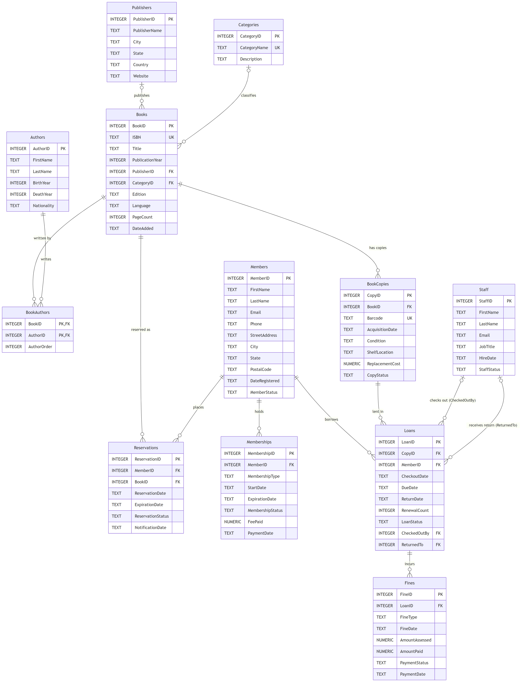
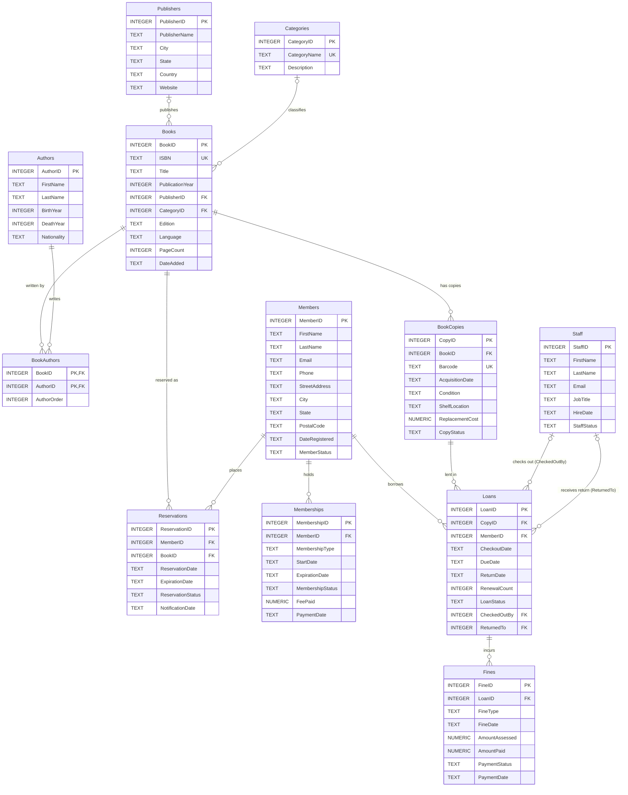

# Library Management System — Summary

## What each table is for

| Table | What it represents | Why it exists |
|---|---|---|
| **Books** | One title/edition in the catalog | Holds the title, ISBN, year and language once, no matter how many copies we own |
| **BookCopies** | One physical book on a shelf, with its own barcode | Copies of the same title wear out, get lost or go out on loan separately, so each needs its own condition and status |
| **Authors** | One person who writes books | An author with several books is stored once instead of retyped on each book |
| **BookAuthors** | "This author worked on this book, in this position" | Connects books and authors, since a book can have several authors |
| **Categories** | A genre, such as Fantasy or History | A fixed list keeps genres consistent (no "Sci-Fi" vs. "Science Fiction") |
| **Publishers** | A publishing company | Publisher details are stored once and shared by all its books |
| **Members** | A library patron | Contact details and whether their account is Active, Suspended, etc. |
| **Memberships** | One paid membership period (e.g., one year) | Renewing adds a new row instead of overwriting the old one, so we keep the payment history |
| **Staff** | A library employee | Lets each loan record who checked it out and who took it back |
| **Loans** | One checkout of one copy by one member | The borrowing history: due dates, returns and renewals |
| **Fines** | One charge tied to a loan | Overdue, lost-book or damaged-book charges, including partial payments and waivers |
| **Reservations** | A member's hold on a title | Lets members get in line for a book when every copy is out |

## How the relationships work

**One-to-many.** Each of these is tracked by a foreign-key column on the "many" side that stores the ID of the row on the "one" side:
- A publisher has many books, and so does a category (`Books.PublisherID`, `Books.CategoryID`).
- A book has many copies (`BookCopies.BookID`) and many reservations (`Reservations.BookID`).
- A member has many memberships, loans and reservations (`MemberID` in each).
- A copy is lent out many times over the years (`Loans.CopyID`).
- A loan can have several fines (`Fines.LoanID`).
- A staff member handles many loans, in two different roles (`Loans.CheckedOutBy` and `Loans.ReturnedTo`).

**Many-to-many.** Books and authors: one book can have several authors, and one author can write several books. A many-to-many relationship can't be stored in a single column, so the **BookAuthors** table sits between them. Each row pairs one `BookID` with one `AuthorID`, and the two together form its primary key, so the same author can't be added to the same book twice. `AuthorOrder` keeps the authors in the order they appear on the cover.

Every foreign key uses `ON DELETE RESTRICT`. The database refuses to delete a member, book or staff member that still has loans, fines or other history attached, so history can't be erased by accident. (SQLite only checks foreign keys after `PRAGMA foreign_keys = ON;`, which has to be run on every connection.)

## A design decision: titles vs. physical copies

I split books into two tables. **Books** is the catalog entry ("*The Great Gatsby*"), and **BookCopies** is each physical item with its own barcode. Loans point to a *copy*, not a title, because a member walks out with one specific book. This lets the library own three copies of a popular title and lend them to three different people at once.

Two rules protect it:
- A partial unique index allows only one unreturned loan per copy. Returned loans don't count, so the same copy can be borrowed again and again over time.
- A trigger refuses to lend a copy that is Lost, Damaged or In Repair.

When a loan is marked Lost, a trigger marks the copy Lost too, and the member is fined its replacement cost. The loan record is never deleted.

## Something that went wrong and was fixed

Dates are stored as text like `2026-10-28`, and a CHECK constraint is supposed to reject impossible dates. Claude's first version, `CHECK (date(x) IS x)`, worked in the newer SQLite command-line tool. In Python's older built-in SQLite (3.33), though, it let **February 30** through. The test run caught it, and the check was changed to `date(x, '+0 days') IS x`, which rejects bad dates in both versions. The same tests showed that "today" defaults used UTC, so a book added in the evening got *tomorrow's* date. Those defaults now use local time.

I also made one change on my own: `books.csv` has no publisher or genre data, so I had Claude **make up** each book's publisher and category. They're sample values, not facts, and some look odd (a true-crime book landed in Children's Literature).

Mermaid source (also in <code>erd.mmd</code>)

